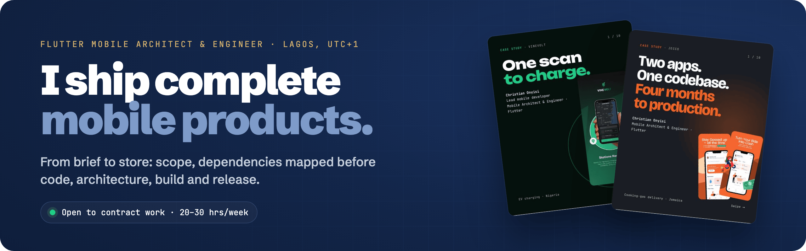
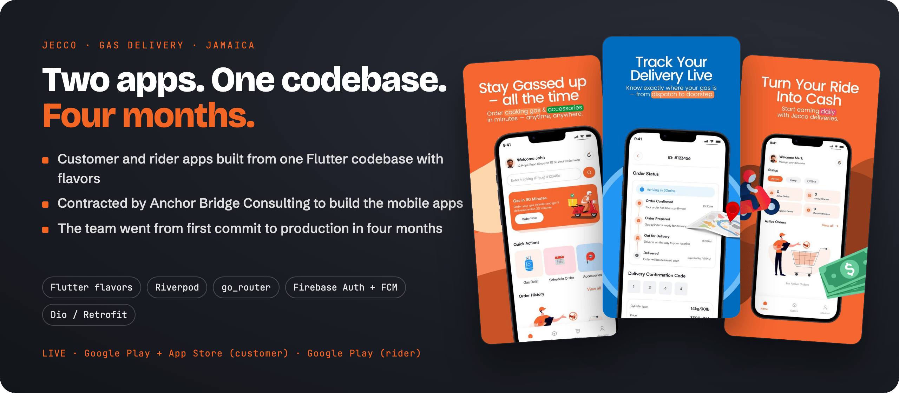
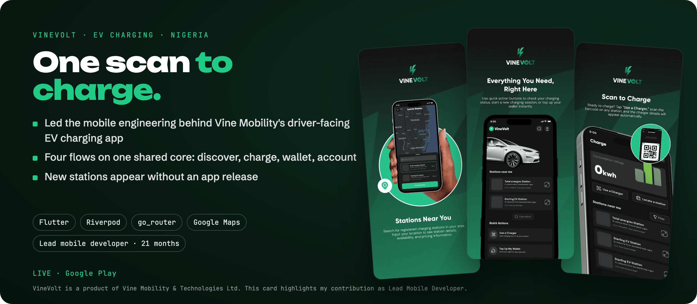
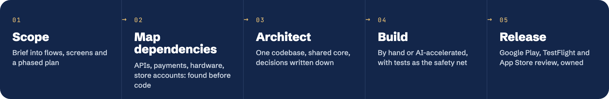
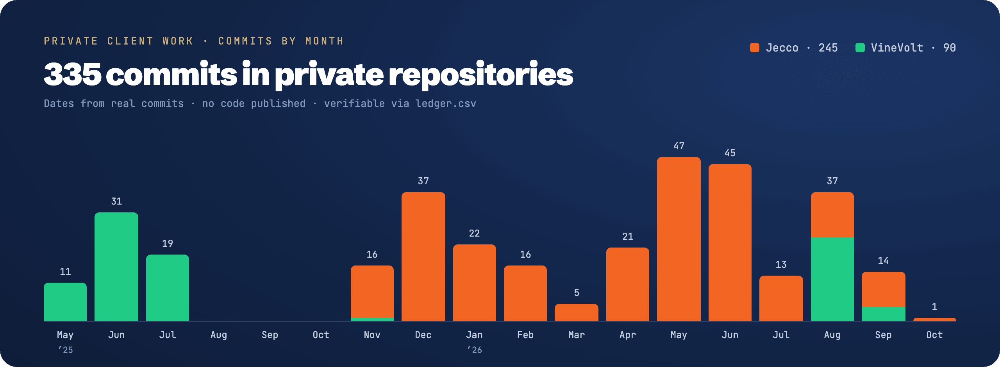

  <a href="https://christianonyisi.netlify.app"><b>Website</b></a> ·
  <a href="https://linkedin.com/in/christian-onyisi-3717971a1"><b>LinkedIn</b></a> ·
  <a href="mailto:onyisichristian@gmail.com"><b>onyisichristian@gmail.com</b></a>

### Live in the stores

  <a href="https://christianonyisi.netlify.app/work/jecco/"><b>Read the case study</b></a> ·
  Customer app: <a href="https://play.google.com/store/apps/details?id=com.jecco.mobile.customer">Google Play</a> / <a href="https://apps.apple.com/us/app/jecco-gas-delivery/id6808539585">App Store</a> ·
  Rider app: <a href="https://play.google.com/store/apps/details?id=com.jecco.mobile.rider">Google Play</a>

  <a href="https://christianonyisi.netlify.app/work/vinevolt/"><b>Read the case study</b></a> ·
  <a href="https://play.google.com/store/apps/details?id=com.vinemobility.vineapp">Google Play</a>

### How I work

### Stack

  

Riverpod · BLoC · go_router · Freezed · Dio / Retrofit · Flutter flavors and multi-app codebases · Android platform channels · payments integration 
AWS Certified Solutions Architect – Associate · AWS Certified AI Practitioner

### On GitHub

Most of my client code lives in private repositories. **[activity-mirror](https://github.com/krysnkem/activity-mirror)** explains my contribution graph: a dated, verifiable record of that private work, with no code.

Public work: [archonit_crypto_app](https://github.com/krysnkem/archonit_crypto_app) (one listing app built three ways: vanilla, Riverpod and BLoC/Cubit) · [flutter_fake_store](https://github.com/krysnkem/flutter_fake_store) (e-commerce with BLoC, go_router and Freezed)
