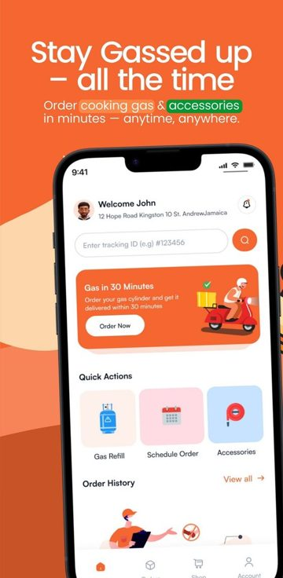
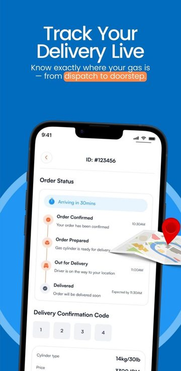
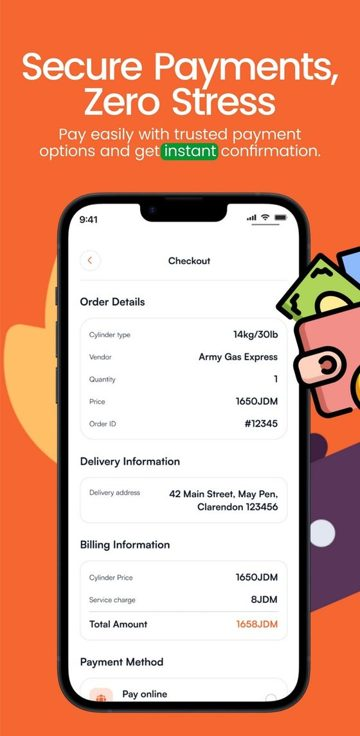
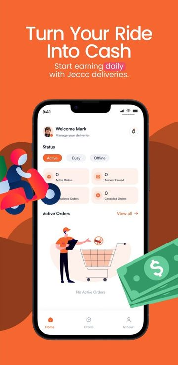
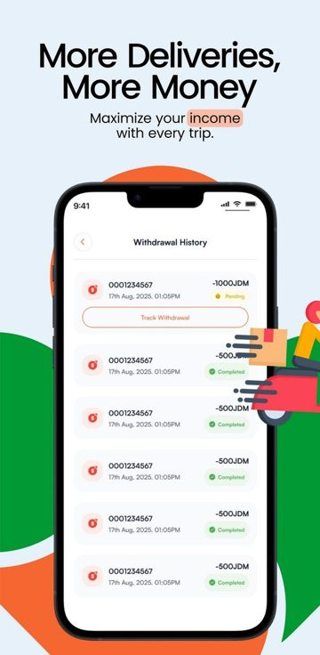
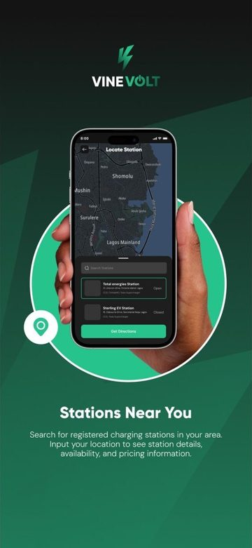
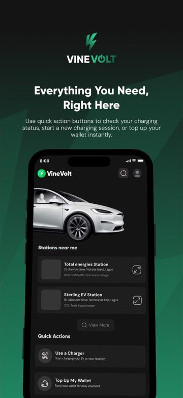
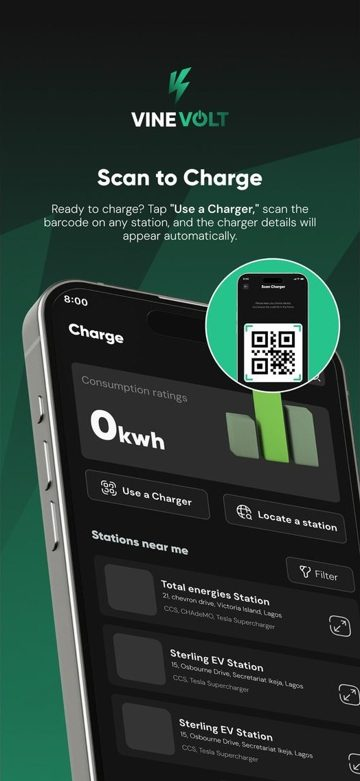

### Christian Onyisi · Flutter mobile architect & engineer

I take mobile products from brief to store. I scope them, map the dependencies before any code is written, architect them, and build them alongside your backend team.

Lagos, Nigeria · UTC+1, overlapping all of Europe and US mornings · **open to contract work, 20–30 hrs/week**

---

#### Live in the stores

| Product | What I did | Where |
|---|---|---|
| **Jecco**: cooking-gas delivery (Jamaica) | Contracted by Anchor Bridge Consulting to build the customer and rider apps as **one Flutter codebase that ships as two apps**. The team went from first commit to production in four months. | Customer: [Google Play](https://play.google.com/store/apps/details?id=com.jecco.mobile.customer) · [App Store](https://apps.apple.com/us/app/jecco-gas-delivery/id6808539585) Rider: [Google Play](https://play.google.com/store/apps/details?id=com.jecco.mobile.rider) |
| **VineVolt**: EV charging (Nigeria) | I led the mobile engineering behind VineVolt, Vine Mobility's driver-facing EV charging app. I architected the product on the mobile side and built the shared core it grows on. | [Google Play](https://play.google.com/store/apps/details?id=com.vinemobility.vineapp) |

**Jecco: customer app**

**Jecco: rider app**

**VineVolt**

Case studies: **[Jecco](https://christianonyisi.netlify.app/work/jecco/)** · **[VineVolt](https://christianonyisi.netlify.app/work/vinevolt/)** · [all work](https://christianonyisi.netlify.app)

VineVolt is a product of Vine Mobility & Technologies Ltd. Jecco was delivered through Anchor Bridge Consulting.

#### How I work

1. **Scope:** turn the brief into flows, screens and a phased plan.
2. **Map dependencies before code:** APIs, payments, hardware, store accounts, approvals. Then prepare for each one.
3. **Architect:** one codebase, a shared core, and features that grow without breaking each other. Decisions are written down.
4. **Build:** by hand, or faster with AI coding agents, with the architecture kept in my hands. Tests are the safety net.
5. **Release:** Google Play, TestFlight and App Store review, handled as part of the job.

#### Stack

Flutter · Dart · Riverpod · BLoC · go_router · Freezed · Dio / Retrofit · Firebase (Auth, FCM, Firestore) · Flutter flavors and multi-app codebases · CI/CD · Kotlin and Android platform channels · payments integration

AWS Certified Solutions Architect – Associate · AWS Certified AI Practitioner

#### On GitHub

Most of my client code lives in private repositories. **[activity-mirror](https://github.com/krysnkem/activity-mirror)** explains my contribution graph: a dated, verifiable record of that private work, with no code.

Public work: [archonit_crypto_app](https://github.com/krysnkem/archonit_crypto_app) (one listing app built three ways: vanilla, Riverpod and BLoC/Cubit) · [flutter_fake_store](https://github.com/krysnkem/flutter_fake_store) (e-commerce with BLoC, go_router and Freezed)

#### Get in touch

[christianonyisi.netlify.app](https://christianonyisi.netlify.app) · [LinkedIn](https://linkedin.com/in/christian-onyisi-3717971a1) · onyisichristian@gmail.com
